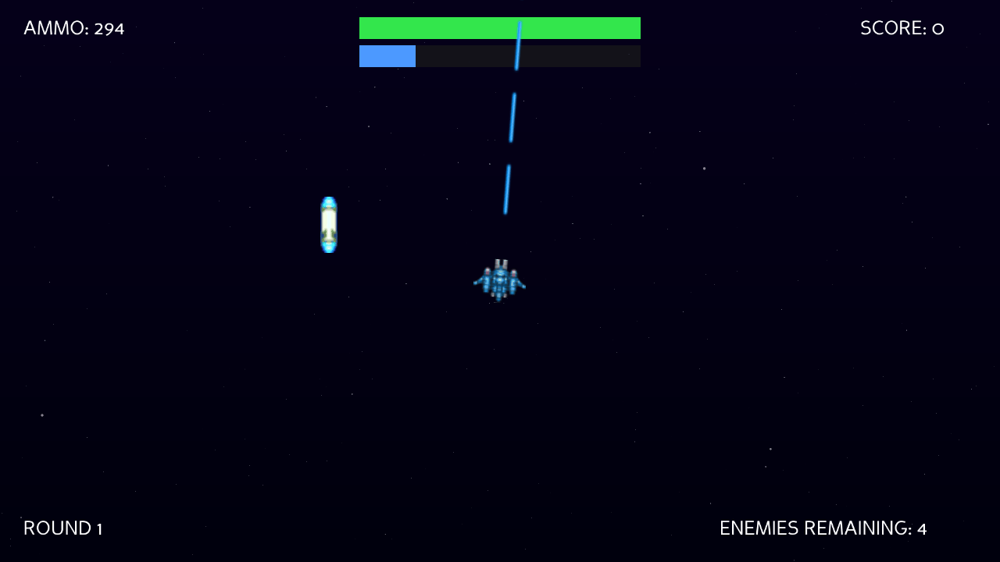

# Orbital Defense

A top-down arcade space shooter built with **Panda3D**. Aim with the mouse, hold
to fire, survive waves of enemies, grab pickups, and pop a shield when things get
hot — all over an animated GLSL starfield.



## Features
- **Wave combat** across rounds with increasing enemy counts; win/lose flow.
- **Three pickup types** collected by shooting them — **ammo**, **HP**, and
  **shield** — with a cap of 3 on screen and an expiry timer.
- **Shield system** — spacebar spends a charge for 1s of invincibility and a
  translucent blue sphere on the ship; a blue charge bar (stacks to 5).
- **Settings screen** with independent **music** and **SFX** volume sliders (over
  the same flowing starfield), plus in-game **pause / resume / continue** (Esc/P).
- **Animated starfield** — a layered GLSL shader on a fullscreen quad.
- Music + shoot/impact sound effects.

## Controls
| Input | Action |
|-------|--------|
| Mouse | aim |
| Left mouse (hold) | fire |
| Space | shield (1s invincibility) |
| Esc / P | pause / resume |

## Run
```bash
pip install panda3d
python main.py
```

## A note on assets
This repo includes the code, the **self-made starfield shader**, and the
**HP / shield / shield-sphere sprites I generated** (`Resources/sprites/`, CC0).
The ship / enemy / projectile sprites (a CC0 "modular ships" set) and the
music / SFX are **not bundled** here — drop your own `player.png`, `enemy1-3.png`,
`playerProjectile.png`, `enemyProjectile.png`, `ammo.png` into `Resources/sprites/`
and `music.ogg` / `projectile.wav` / `impact.wav` into `Resources/audio/` to run
it end-to-end.

The code in this repo is licensed under **MIT** (see `LICENSE`); the CC0-marked
assets above are my own work and are additionally dedicated to the public domain,
which only broadens what MIT already allows — there's no conflict. The
not-bundled third-party ship/enemy/projectile sprites and audio you supply
yourself are outside this repo and its license; check their own terms before use.

## Tech
Panda3D · DirectGUI (HUD, sliders, menus) · GLSL fragment shader (starfield) ·
2D sprite gameplay on `aspect2d`.
